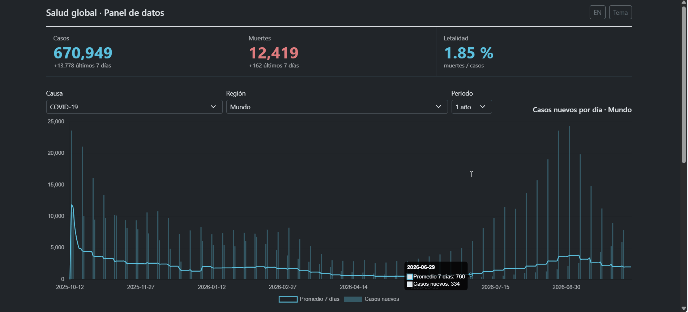
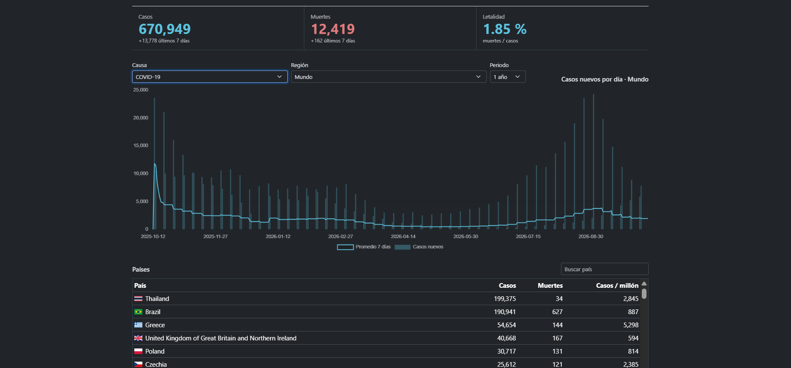
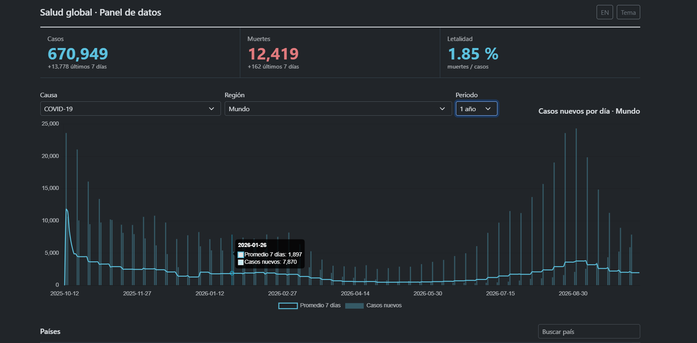
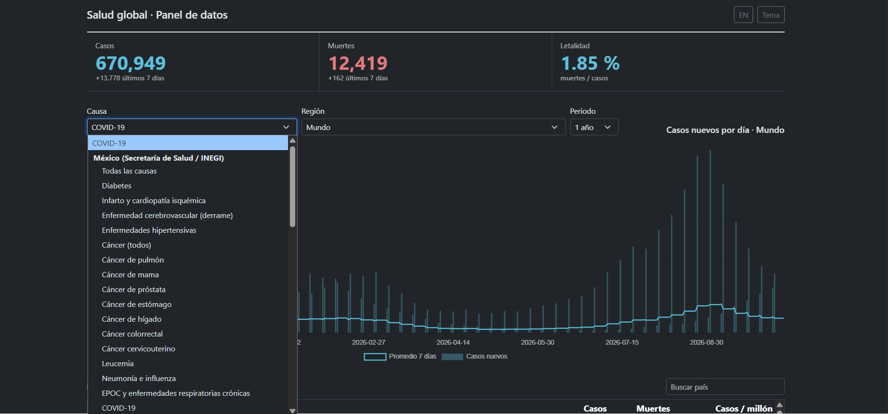
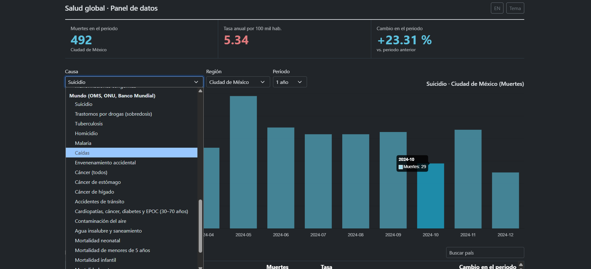
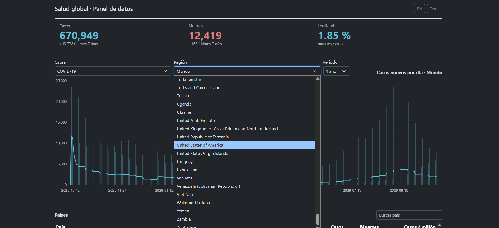
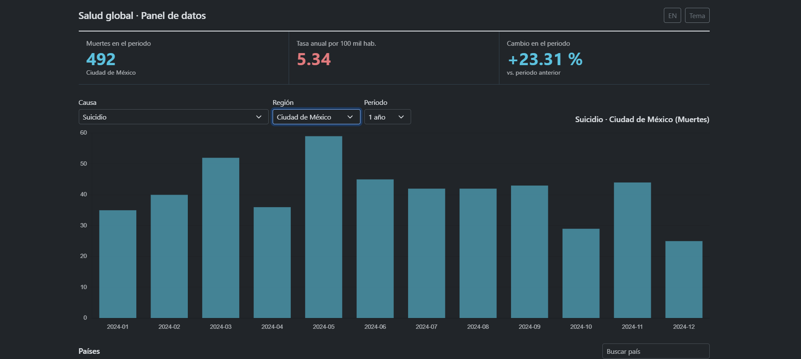
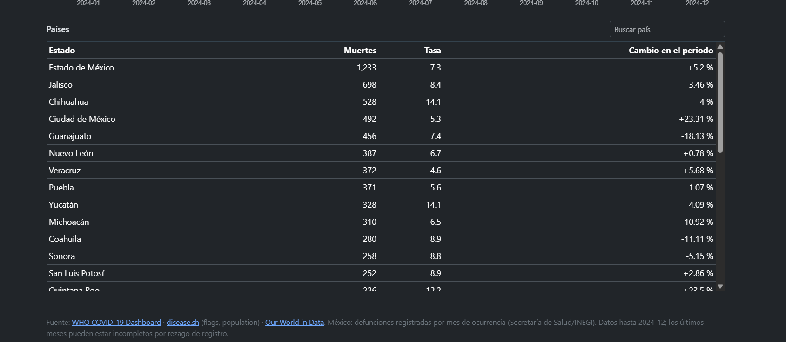
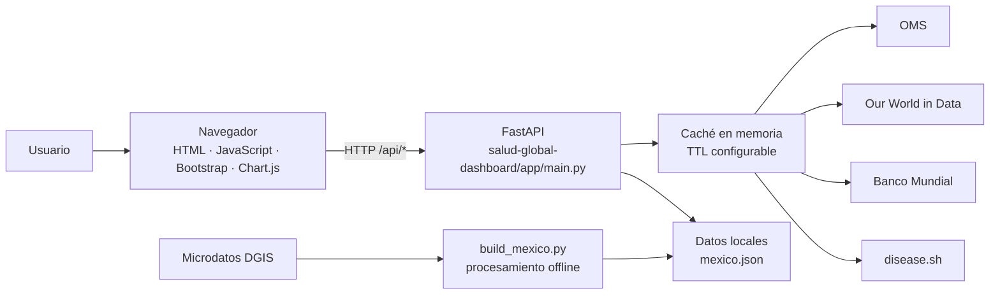

# 🌍 Salud Global · Panel de datos

Dashboard web interactivo que unifica **datos de salud pública de fuentes oficiales** (OMS, Our World in Data, Banco Mundial, Secretaría de Salud/INEGI) en una sola interfaz: COVID-19 actualizado, 22 causas de muerte por país y 35 causas de muerte para México por estado y mes.

**Stack:** Python 3.12 · FastAPI · JavaScript vanilla · Bootstrap 5 · Chart.js · Docker · Pytest

**Demo en vivo:** [salud-global-dashboard.onrender.com](https://salud-global-dashboard.onrender.com/) · [Documentación de la API](https://salud-global-dashboard.onrender.com/api/docs)



## ✨ Qué demuestra este proyecto

- **Backend de API tipada** con FastAPI y Pydantic: validación de parámetros, documentación automática (`/api/docs`) y endpoint de salud (`/health`).
- **Integración y normalización de datos externos**: CSV de la OMS, APIs de Our World in Data, Banco Mundial y disease.sh, con **caché en memoria** (TTL configurable) para no saturar las fuentes.
- **Pipeline de datos propio** (`salud-global-dashboard/scripts/build_mexico.py`): procesa microdatos de defunciones de la DGIS y genera un JSON compacto por estado, mes y causa.
- **Frontend ligero sin frameworks**: JavaScript vanilla, gráficas con Chart.js, tablas con búsqueda, **interfaz bilingüe (ES/EN)** y **tema claro/oscuro**.
- **Buenas prácticas de producción**: cabeceras de seguridad, configuración por variables de entorno, contenedor Docker con usuario no root y *healthcheck*, pruebas automatizadas.

## 📊 Qué incluye

| Vista | Fuente | Granularidad |
|---|---|---|
| COVID-19 | [OMS](https://data.who.int/dashboards/covid19/data) (banderas y población: [disease.sh](https://disease.sh)) | Diaria/semanal, filtros 90 días – todo |
| Causas mundiales (suicidio, drogas, tuberculosis, homicidio, cáncer, mortalidad infantil…) | [Our World in Data](https://ourworldindata.org) y [Banco Mundial](https://data.worldbank.org) | Anual, con 2–4 años de retraso |
| México (diabetes, infarto, homicidio, sobredosis, cánceres…) | Secretaría de Salud / INEGI (defunciones registradas) | Mensual por estado, 2019–2024 |

> Los últimos meses de México pueden estar incompletos por rezago de registro.

## 🖼️ Capturas

### COVID-19 a nivel mundial
KPIs (casos, muertes, letalidad), serie diaria con promedio móvil de 7 días y ranking de países con bandera, casos, muertes y casos por millón.



Detalle interactivo: al pasar el cursor se muestra el valor diario y el promedio de 7 días.



### Selección de causa y región
Selector agrupado por fuente: COVID-19, México (Secretaría de Salud/INEGI) y Mundo (OMS, ONU, Banco Mundial). La región permite elegir entre todos los países.

| Causas de México | Causas mundiales | Selector de región |
|---|---|---|
|  |  |  |

### México por estado y mes
Ejemplo: suicidio en Ciudad de México durante 2024, con muertes del periodo, tasa anual por 100 mil habitantes y cambio frente al periodo anterior.



Ranking de todos los estados con muertes, tasa y variación porcentual, más las fuentes citadas al pie.



## 🧱 Arquitectura



El código de la aplicación, las pruebas, el Dockerfile y los recursos visuales están dentro de `salud-global-dashboard/`; este README está en la raíz del repositorio.

## 🚀 Ejecutar en local

```bash
cd salud-global-dashboard
python -m venv .venv
source .venv/bin/activate        # Windows: .venv\Scripts\activate
pip install -r requirements-dev.txt
pytest
uvicorn app.main:app --reload    # http://localhost:8000 · docs: /api/docs
```

Con Docker:

```bash
docker build -t salud-global-dashboard salud-global-dashboard
docker run -p 8000:8000 salud-global-dashboard
```

## 🔌 API

- `GET /api/global?days=` · `GET /api/countries?days=` · `GET /api/history?days=` · `GET /api/countries/{pais}/history?days=`
- `GET /api/causes/{causa}`: serie anual por país
- `GET /health`

Documentación interactiva (Swagger) en `/api/docs`.

## 🇲🇽 Datos de México

`salud-global-dashboard/app/static/mexico.json` se genera con los microdatos de defunciones (archivos `DEFUN_AAAA.zip` de la DGIS). Cuando se publique un año nuevo, agrégalo en `FILES` en `salud-global-dashboard/scripts/build_mexico.py` y ejecuta desde la carpeta de la aplicación:

```bash
cd salud-global-dashboard
python scripts/build_mexico.py
```

## ⚙️ Variables de entorno

- `WHO_CSV_URL`, `COVID_META_URL`, `OWID_BASE`, `WB_BASE`: cambian de fuente sin tocar código
- `CACHE_TTL`: segundos de caché (21600) · `LOG_LEVEL` (INFO)

## ☁️ Despliegue

La aplicación está desplegada en Render: [https://salud-global-dashboard.onrender.com/](https://salud-global-dashboard.onrender.com/). El endpoint de salud está disponible en [`/health`](https://salud-global-dashboard.onrender.com/health).

## 📚 Fuentes y créditos

[OMS](https://data.who.int/dashboards/covid19/data) · [disease.sh](https://disease.sh) · [Our World in Data](https://ourworldindata.org) · [Banco Mundial](https://data.worldbank.org) · Secretaría de Salud / INEGI (DGIS).
